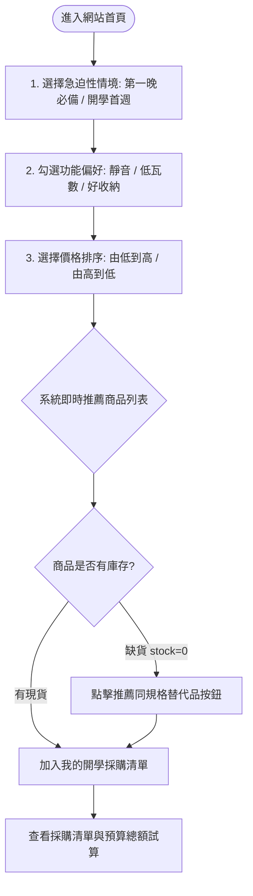

# 產品規格書 (SPEC.md) - 校園生活用品商品推薦網站（宿舍電器篇）

## 1. 專案目的 (Purpose)
針對剛進入大學校園的大一住宿新生，提供一套直覺、貼心且防踩雷的宿舍電器推薦系統。解決新生「不知道第一天該買什麼」、「擔心電器瓦數過高跳電違規」、「害怕運轉噪音吵到室友」以及「宿舍空間狹小不易收納」等核心痛點，協助新生以最少的時間與合理的預算挑選最合規的生活用品。

---

## 2. 目標對象 (Target Audience)
* **主要客群**：大一剛入學之住宿新鮮人。
* **客群特質**：
  * 對宿舍實際硬體規格（如插座位置、限電瓦數、空間坪數）缺乏經驗。
  * 採購預算多為個人零用錢或打工收入，重視實用性與 CP 值。
  * 重視室友關係，傾向避免製造噪音或安全困擾。

---

## 3. 操作流程 (User Flow)

---

## 4. 功能清單與範疇劃分 (Features Scope)

### 4.1 必做核心功能 (MVP Required)
1. **急迫性情境切換 (Urgency Scenario Tabs)**：
   * 提供「第一晚沒它不能睡」與「開學第一週再補買」兩大情境分類。
2. **功能痛點多選篩選器 (Feature Preference Filter)**：
   * 提供多選 Tag 按鈕：`超靜音`、`宿舍低瓦數`、`折疊省空間`。
   * 勾選後即時進行條件交集 (AND) 或聯集 (OR) 過濾。
3. **價格排序與小資標籤 (Price Sorting & Badges)**：
   * 支援「價格由低到高」與「價格由高到低」排序。
   * 商品卡片視覺化呈現「小資省錢款」與「質感升級款」等級標籤。
4. **推薦商品卡片 (Recommendation Card)**：
   * 展示代表性 Emoji 圖示 (`icon`)、專屬卡片底色 (`color`)、商品名稱、價格、低瓦數標示、庫存量。
   * 核心推薦特色：清楚呈現「為什麼推薦它」的理由文字 (`recommend_reason`)。
5. **智慧缺貨替代推薦 (Smart Stockout Substitution)**：
   * 當商品庫存為 0 時，卡片自動標記「暫時缺貨」。
   * 主動顯示「👉 推薦替代品」按鈕，點擊後聚焦推薦同規格之現貨商品。
6. **暫存採購清單試算 (Checklist & Budget Estimator)**：
   * 可將推薦商品加入採購清單，即時計算總金額與項目數量。

### 4.2 選做 / 課後自學延伸功能 (Optional / Future Stretch)
* **商品詳細規格彈窗 (Detail Modal)**：點擊卡片跳出檢驗認證 (BSMI)、詳細尺寸、重量等進階資訊。
* **商品雙向比較表 (Comparison View)**：勾選兩件商品橫向比對瓦數、價格與功能。
* **預算分配與評分圖表 (Charts & Visual Analytics)**：使用 Canvas / 圖表庫呈現開學預算比例分佈圖。

---

## 5. 輸入與輸出規範 (Inputs & Outputs)

### 5.1 使用者輸入 (Inputs)
| 輸入項目 | 型態 / 格式 | 說明 | 預設值 |
| :--- | :--- | :--- | :--- |
| `selectedUrgency` | 字串 (`"all"` \| `"first_night"` \| `"first_week"`) | 點選情境分類按鈕 | `"first_night"` |
| `selectedFeatures` | 字串陣列 (例如 `["quiet", "low_watt"]`) | 複選痛點標籤按鈕 | `[]` (全部) |
| `sortBy` | 字串 (`"price_asc"` \| `"price_desc"`) | 選擇價格排序方式 | `"price_asc"` |
| `searchKeyword` | 字串 (純文字) | 搜尋關鍵字（可選） | `""` |
| `triggerReplaceId` | 字串 / 數字 | 點擊缺貨卡片上的替代品按鈕 | 無 |

### 5.2 系統輸出 (Outputs)
* **過濾推薦清單**：動態更新的商品卡片網格，每個卡片輸出：
  * 商品圖示 (`icon`)、專屬底色 (`color`)、名稱 (`name`)、價格 (`price`)、庫存狀態 (`stock`)。
  * 痛點標籤清單、小資/升級等級標記。
  * 專屬推薦理由 (`recommend_reason`)。
* **替代品切換效果**：平滑導向或置換為替代商品。
* **採購總額摘要**：已選商品數量累計與總金額 (NT$)。
* **空狀態提示 (Empty State)**：當無任何符合篩選條件商品時，顯示友善文案與「重設篩選」按鈕。

---

## 6. 規則與例外處理 (Business Rules & Exceptions)

### 6.1 推薦與篩選規則
1. **情境規則**：若選擇特定急迫性，僅顯示該急迫性分類之商品（若選「全部」則不限制）。
2. **偏好標籤過濾**：若使用者勾選多個偏好標籤，系統採「符合所有已勾選標籤 (AND)」邏輯過濾；若無勾選任何標籤則代表不限。
3. **排序規則**：
   * `price_asc`：依 `price` 數值由小到大排列。
   * `price_desc`：依 `price` 數值由大到小排列。

### 6.2 缺貨處理規則
* 若商品 `stock === 0`：
  1. 卡片外觀加上反灰透明度或「已售完」醒目標籤。
  2. 隱藏常規加入清單按鈕，替換為「👉 推薦替代品：[替代商品名稱]」按鈕。
  3. 點擊該按鈕後，頁面自動篩選或高亮該替代商品，並提供一鍵加入清單。

### 6.3 例外處理 (Edge Cases)
* **過度篩選導致查無商品 (Empty Result)**：
  * 不可顯示空白畫面。必須顯示圖文提示：「找不到符合條件的宿舍電器，建議放寬篩選條件」，並附帶一鍵「重設條件」按鈕。
* **資料載入失敗**：
  * 若 `products.json` 讀取失敗，畫面上方顯示友善錯誤提示：「商品資料載入失敗，請重新整理頁面」。

---

## 7. 畫面需求與版面佈局 (UI Layout Requirements)

1. **頂部導覽列 (Header)**：
   * 網站名稱（例如：🎒 校園生活好物誌 - 宿舍電器合規指南）。
   * 簡短副標題（例如：專為大一新生把關，不怕跳電、不吵室友）。
2. **情境與篩選控制區 (Filter Bar)**：
   * **情境切換**：大按鈕切換「🛌 第一晚必備」與「📚 開學首週補齊」。
   * **痛點標籤**：膠囊式按鈕（`🔊 超靜音`、`⚡ 宿舍低瓦數`、`📦 可折疊收納`）。
   * **排序選單**：下拉或按鈕切換價格排序。
3. **商品推薦卡片網格 (Product Grid)**：
   * 響應式佈局（手機單欄、平板雙欄、電腦三/四欄）。
   * 每張卡片包含專屬背景色彩（柔和色系）、大尺寸 Emoji 圖示、推薦理由浮水印/引用區塊。
4. **採購清單抽屜 / 側邊摘要 (Shopping Drawer / Summary)**：
   * 顯示目前已挑選的電器品項、總件數與預算總額（純瀏覽器內部狀態）。

---

## 8. 技術限制與規範 (Technical Constraints)

* **核心技術棧**：Vite 構建工具 + 純 JavaScript (Vanilla JS) + 語意化 HTML5 / 現代 CSS3。
* **執行環境**：純現代瀏覽器端 (Chrome / Edge / Firefox / Safari) 運作，無需配置 Node.js 執行期伺服器。
* **安全性與無外部相依**：
  * 不連接任何外部付費 AI API。
  * 不串接任何真實金流或敏感個資。
  * 不依賴外部後端資料庫，資料來源為本機靜態檔案 `public/products.json`。
* **資料保存原則與限制**：
  * 本階段所有操作（篩選狀態、採購清單）以瀏覽器記憶體變數運作為主。
  * **重要約定**：未來若需持久化（如使用瀏覽器 `localStorage` 儲存採購清單以防重新整理遺失），必須先向使用者說明存儲方式、儲存容量限制及跨裝置無法同步之限制，經同意後方可加入。

---

## 9. 本次明確不做的項目 (Out of Scope)
* ❌ 會員系統：不實作使用者註冊、登入或密碼重設。
* ❌ 訂單與購物車結帳：不實作信用卡付款、超商取貨或真實物流系統。
* ❌ 後端 API 服務：不搭建 Express/Nest/Python 等伺服器。
* ❌ 外部雲端資料庫：不使用 MongoDB, MySQL, Firebase 等。
* ❌ 付費 LLM/AI 介接：推薦規則以純 JavaScript 演算法規則引擎達成，不消耗 API Key。
